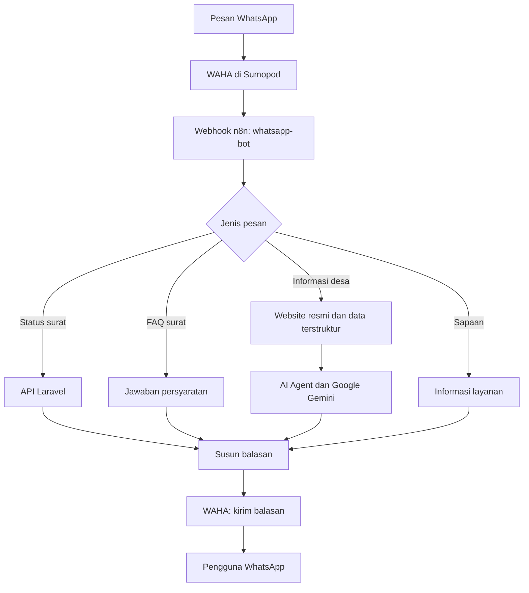

# Sistem Pelayanan Desa Dukuhtengah

**Selamat datang di Sistem Pelayanan Desa Dukuhtengah!**

Platform pelayanan administrasi untuk warga Desa Dukuhtengah, Kecamatan Bojong. Aplikasi ini menyediakan pengajuan surat secara daring, pendataan monografi RT, pengelolaan aduan masyarakat, dan chatbot WhatsApp yang terhubung dengan n8n.

Selain mengecek status pengajuan surat, chatbot dapat menjawab pertanyaan persyaratan surat dan informasi seputar Desa Dukuhtengah. Jawaban informasi desa diproses menggunakan Google Gemini berdasarkan konten website resmi desa dan data terstruktur dalam workflow.

## Fitur

| Pengguna | Kemampuan |
| --- | --- |
| Admin | Dashboard, pengelolaan layanan dan formulir dinamis, publikasi versi formulir, verifikasi dan aktivasi akun, pemeriksaan pengajuan, persetujuan atau penolakan surat, serta unggah dokumen hasil. |
| Admin | Pengelolaan arsip dan ekspor, penanganan aduan, pemantauan monografi per RT, pembukaan kembali laporan untuk perbaikan, pengaturan formulir monografi, serta ekspor Excel. |
| Ketua RT | Dashboard, pengajuan surat, riwayat pengajuan, pengisian monografi tahunan, penyimpanan draft, pengiriman laporan, riwayat monografi, serta pembaruan profil. |
| Warga | Registrasi dengan OTP email, pengajuan surat dan lampiran, pemantauan status, unduh dokumen hasil, serta pembaruan profil. |
| Publik | Melihat layanan aktif dan mengirim aduan melalui halaman utama. |

Admin, RT, dan Warga memiliki akses notifikasi dalam aplikasi. Pengajuan layanan oleh RT dan Warga membutuhkan akun yang telah diverifikasi dan berstatus aktif.

Seeder menyediakan 12 jenis layanan surat dan 11 kategori monografi. Admin perlu menyiapkan field formulir layanan dan memublikasikannya, serta menambahkan field monografi sebelum digunakan untuk pengisian laporan.

## Teknologi dan Kebutuhan

| Komponen | Teknologi / kebutuhan |
| --- | --- |
| Backend web | PHP 8.3+, Laravel 12, Composer 2, ekstensi PHP yang dibutuhkan Laravel, `gd`, `zip`, dan driver PDO untuk database. |
| Frontend | Blade, Tailwind CSS 4, Vite 7, Node.js 22.12+ dan npm. |
| Database lokal | MySQL; contoh konfigurasi menggunakan database `pelayanan_desa`. |
| Ekspor spreadsheet | PhpSpreadsheet. |
| Email OTP | Mailer Laravel; konfigurasi awal menggunakan `log`, pengiriman email dapat menggunakan SMTP. |
| Chatbot utama | WAHA dan n8n di Sumopod, kredensial Google Gemini, serta aplikasi Laravel yang dapat diakses dari n8n. |
| Integrasi alternatif | Express 5 dan Meta WhatsApp Cloud API melalui `wa-service`. |

Pengembangan lokal dapat menggunakan Laragon di Windows. Perintah instalasi di bawah menggunakan PowerShell.

## Struktur Repo

```text
.
├── README.md
├── sistem-pelayanan-desa/           # Aplikasi Laravel
│   ├── app/                        # Controller, model, dan layanan aplikasi
│   ├── database/                   # Migrasi dan seeder
│   ├── resources/                  # View Blade, CSS, dan JavaScript
│   ├── routes/                     # Route web dan API
│   ├── tests/                      # Pengujian Laravel
│   └── README.md                   # Panduan operasional dan deployment web
└── wa-service/                     # Service alternatif Express–Meta
    ├── index.js
    ├── test/
    ├── README.md
    └── n8n/
        ├── workflow-n8n.json               # Workflow lengkap WAHA, FAQ, dan Gemini
        ├── whatsapp-cek-status-surat.json  # Template cek status untuk Express–Meta
        └── README.md                      # Panduan template Express–Meta
```

## Instalasi Lokal Aplikasi Web

### 1. Clone dan instal dependensi

```powershell
git clone https://github.com/LollYeahhh/sistem-pelayanan-desa.git TUGAS-AKHIR
cd TUGAS-AKHIR\sistem-pelayanan-desa
Copy-Item .env.example .env
composer install
npm ci
```

Jika repo sudah tersedia secara lokal, langsung masuk ke direktori `sistem-pelayanan-desa`. Salin `.env.example` hanya pada instalasi baru agar konfigurasi yang sudah ada tetap tersimpan.

### 2. Konfigurasikan database

Jalankan MySQL melalui Laragon atau layanan database yang digunakan. Buat database kosong bernama `pelayanan_desa`, misalnya melalui pengelola database Laragon, lalu sesuaikan `.env`:

```dotenv
APP_NAME="Sistem Pelayanan Desa"
APP_ENV=local
APP_DEBUG=true
APP_URL=http://127.0.0.1:8000

DB_CONNECTION=mysql
DB_HOST=127.0.0.1
DB_PORT=3306
DB_DATABASE=pelayanan_desa
DB_USERNAME=root
DB_PASSWORD=

SESSION_DRIVER=database
CACHE_STORE=database
QUEUE_CONNECTION=database
```

Isi username dan password sesuai database lokal. Tabel session, cache, dan queue disediakan oleh migrasi aplikasi.

### 3. Siapkan aplikasi dan data awal

Jalankan dari direktori `sistem-pelayanan-desa`:

```powershell
php artisan key:generate
php artisan migrate --seed
php artisan storage:link
```

Gunakan `migrate --seed` untuk database baru. Seeder memasukkan akun dan data awal dengan operasi insert, sehingga menjalankannya kembali pada database yang sudah diisi dapat menyebabkan duplikasi atau konflik data. Untuk pembaruan database yang sudah digunakan, jalankan `php artisan migrate`.

Storage link menyediakan akses lampiran publik melalui `/storage`. Dokumen hasil surat disimpan di storage privat dan diunduh melalui controller aplikasi.

### 4. Jalankan Laravel dan Vite

Terminal pertama, di direktori `sistem-pelayanan-desa`:

```powershell
php artisan serve
```

Terminal kedua, di direktori yang sama:

```powershell
npm run dev
```

Buka aplikasi di `http://127.0.0.1:8000`, lalu masuk melalui `/login`. Aplikasi web dapat dijalankan secara lokal terlebih dahulu; penggunaan chatbot membutuhkan konfigurasi integrasi pada bagian berikutnya.

Untuk menghasilkan aset frontend siap deploy:

```powershell
npm run build
```

### Akun demo

Akun berikut dibuat oleh [DatabaseSeeder](sistem-pelayanan-desa/database/seeders/DatabaseSeeder.php) untuk pengembangan lokal:

| Peran | Email | Password |
| --- | --- | --- |
| Admin | `admin@desa-dukuhtengah.id` | `dkt2026` |
| RT | `rt01@desa-dukuhtengah.id` | `password` |
| Warga | `budidoreso@sample.com` | `password` |

Ketiga akun awal sudah aktif dan terverifikasi. Ganti kredensial demo sebelum menggunakan akun tersebut di lingkungan produksi.

### Email dan OTP registrasi

Konfigurasi bawaan `MAIL_MAILER=log` menulis isi email, termasuk OTP, ke log aplikasi di `storage/logs`; email tidak dikirim ke kotak masuk. OTP berlaku selama 10 menit dengan jeda kirim ulang 120 detik.

Untuk mengirim OTP melalui email, sesuaikan konfigurasi SMTP di `.env` dengan penyedia email:

```dotenv
MAIL_MAILER=smtp
MAIL_SCHEME=smtp
MAIL_HOST=smtp.example.com
MAIL_PORT=587
MAIL_USERNAME=isi-username-smtp
MAIL_PASSWORD=isi-password-smtp
MAIL_FROM_ADDRESS=noreply@example.com
MAIL_FROM_NAME="${APP_NAME}"
```

Host, port, skema, dan kredensial di atas adalah contoh dan perlu disesuaikan. Setelah mengubah konfigurasi, jalankan:

```powershell
php artisan config:clear
```

Verifikasi email dengan OTP merupakan bagian dari registrasi. Akun baru tetap membutuhkan verifikasi dan aktivasi oleh admin untuk mengajukan layanan.

## Chatbot WhatsApp

Workflow utama tersedia di [workflow-n8n.json](wa-service/n8n/workflow-n8n.json). Integrasi ini menggunakan WAHA dan n8n yang dijalankan melalui Sumopod.

| Kebutuhan | Contoh pesan | Sumber jawaban |
| --- | --- | --- |
| Status pengajuan surat | `Cek status surat REG-ABC12345` | API Laravel yang membaca data pengajuan. |
| Persyaratan surat | `Apa syarat membuat KTP?` | Jawaban FAQ yang disiapkan dalam workflow. |
| Alamat kantor desa | `Di mana alamat kantor Desa Dukuhtengah?` | Konten website resmi dan data terstruktur dalam workflow, diproses oleh Gemini. |
| Kegiatan desa | `Apa agenda kegiatan desa?` | Informasi yang tersedia dari website resmi, diproses oleh Gemini. |

Ganti nomor registrasi contoh dengan nomor pengajuan yang tersedia di halaman riwayat. Format nomor registrasi adalah `REG-` diikuti delapan karakter huruf atau angka.

FAQ mencakup KTP, Kartu Keluarga, domisili, akta kelahiran, SKTM, dan surat keterangan usaha. Cabang informasi desa mengambil konten dari website resmi `https://dukuhtengah-bojong.desa.id/`, menyiapkan konteks yang relevan, lalu meneruskannya kepada AI Agent dengan Google Gemini dan memori percakapan singkat.



Workflow menginstruksikan AI untuk menjawab berdasarkan data yang disediakan. Jika jawaban belum tersedia, pengguna diarahkan untuk menghubungi kantor desa atau mengunjungi website resmi. Pertanyaan di luar topik Desa Dukuhtengah dan layanan desa mendapat respons di luar cakupan. Ketepatan jawaban bergantung pada konten yang dapat diambil dan pembaruan data terstruktur dalam workflow.

### Setup WAHA dan n8n melalui Sumopod

1. **Siapkan platform.** Buat akun di [Sumopod](https://sumopod.com/), lalu berlangganan layanan **WAHA** dan **n8n** yang digunakan untuk integrasi proyek ini. Siapkan alamat akses masing-masing layanan, API key WAHA, dan kredensial Google Gemini.
2. **Impor workflow.** Buka n8n yang tersedia di Sumopod. Dari menu workflow, pilih **Import from File**, lalu pilih `wa-service/n8n/workflow-n8n.json` dari repo ini. Panduan tersedia pada [dokumentasi impor workflow n8n](https://docs.n8n.io/workflows/export-import/).
3. **Sesuaikan konfigurasi node.** Ganti konfigurasi bawaan sesuai lingkungan sendiri menggunakan tabel di bawah. Pastikan Laravel dapat dijangkau dari layanan n8n; alamat `localhost` komputer pengembang tidak menunjuk ke aplikasi lokal ketika dipanggil dari Sumopod.
4. **Hubungkan WhatsApp.** Buka dashboard WAHA, siapkan sesi dengan nama yang sama dengan konfigurasi node pengiriman, lalu hubungkan akun WhatsApp dengan memindai QR sesi. Lihat [dokumentasi dashboard WAHA](https://waha.devlike.pro/docs/how-to/dashboard/).
5. **Aktifkan workflow dan pasang webhook.** Simpan, lalu aktifkan atau publikasikan workflow sesuai versi n8n. Pada node `Webhook`, salin **Production URL** untuk metode `POST` dan path `whatsapp-bot`. Pasang URL tersebut sebagai webhook sesi WAHA untuk event pesan masuk `message`. Gunakan URL produksi yang ditampilkan n8n; webhook produksi tersedia setelah workflow dipublikasikan. Lihat [dokumentasi Webhook n8n](https://docs.n8n.io/integrations/builtin/core-nodes/n8n-nodes-base.webhook/) dan [penerimaan pesan WAHA](https://waha.devlike.pro/docs/how-to/receive-messages/).
6. **Uji alur pesan.** Dari nomor WhatsApp lain, kirim contoh pesan pada tabel kemampuan chatbot. Periksa riwayat eksekusi n8n, hasil API Laravel, dan balasan yang dikirim WAHA.

Konfigurasi yang perlu disesuaikan setelah impor:

| Node / bagian | Konfigurasi |
| --- | --- |
| `HTTP Request Laravel1` | Ganti domain API dengan `https://domain-laravel-anda.example/api/cek-surat/` dan pertahankan expression nomor registrasi dari `surat_id`. |
| `HTTP Request WAHA1` | Ganti URL menjadi `https://domain-waha-anda.example/api/sendText`, isi header `X-Api-Key` dengan API key milik sendiri, dan sesuaikan body `session` dengan sesi WhatsApp yang dihubungkan. Pertahankan expression penerima dan teks balasan. |
| `Google Gemini Chat Model` | Hubungkan kredensial Google Gemini milik sendiri dan pilih model yang tersedia pada akun serta versi n8n yang digunakan. Referensi kredensial dari hasil impor perlu dihubungkan kembali pada instance sendiri. |
| `Webhook` | Metode `POST`, path `whatsapp-bot`, dan respons melalui node `Respond to Webhook1`. |
| `GET Website Desa` dan `Strip HTML & Prep` | Periksa URL sumber, data terstruktur desa, dan konteks informasi yang diberikan ke AI Agent. Perbarui data ketika informasi desa berubah. |
| Node FAQ, sapaan, dan balasan | Sesuaikan tautan portal pelayanan, persyaratan, serta informasi operasional dengan lingkungan dan data desa yang digunakan. |

Contoh bentuk URL webhook produksi:

```text
https://domain-n8n-anda.example/webhook/whatsapp-bot
```

Semua domain dan kredensial contoh pada panduan ini harus diganti dengan konfigurasi milik sendiri. Konfigurasi integrasi WAHA dilakukan pada layanan WAHA dan node workflow n8n.

### Integrasi alternatif: Express dan Meta WhatsApp Cloud API

Repo juga menyediakan service Express di `wa-service` dan template [whatsapp-cek-status-surat.json](wa-service/n8n/whatsapp-cek-status-surat.json). Alur alternatif ini menerima webhook dari Meta, meneruskan pesan ke n8n melalui path `wa-incoming`, kemudian mengirim balasan melalui Meta Graph API. Template tersebut berfokus pada pengecekan status surat.

Alur utama WAHA pada `workflow-n8n.json` mengirim balasan langsung dari n8n ke WAHA dan tidak membutuhkan proses Express tersebut. Pilih konfigurasi sesuai integrasi yang dijalankan. Variabel `VERIFY_TOKEN`, `WHATSAPP_TOKEN`, `PHONE_NUMBER_ID`, dan `N8N_WEBHOOK_URL` pada `wa-service/.env.example` digunakan untuk jalur Express–Meta.

Petunjuk konfigurasi dan operasional jalur alternatif tersedia di [README wa-service](wa-service/README.md) dan [panduan template n8n Express–Meta](wa-service/n8n/README.md).

## Pengujian

Jalankan pengujian Laravel dari direktori `sistem-pelayanan-desa`:

```powershell
php artisan test
```

Konfigurasi PHPUnit menggunakan SQLite dalam memori; aktifkan driver PDO SQLite untuk menjalankan pengujian tersebut. Suite mencakup antara lain registrasi OTP, API status surat, alur monografi dan ekspor Excel, serta akses lampiran dan dokumen hasil.

Untuk menjalankan pengujian Laravel sekaligus build frontend sebelum rilis:

```powershell
composer run release:check
```

Pengujian service Express dijalankan secara terpisah dari direktori `wa-service`:

```powershell
npm ci
npm test
```

Pengujian Express memeriksa health endpoint, verifikasi webhook, penerusan pesan ke n8n, dan pengiriman balasan ke Meta menggunakan HTTP client pengganti. Pengujian tersebut tidak memvalidasi koneksi langsung WAHA, n8n di Sumopod, maupun Google Gemini.

Untuk verifikasi integrasi WAHA secara langsung, jalankan langkah uji pada bagian setup Sumopod. Coba juga nomor registrasi yang tidak ditemukan, pesan cek status tanpa nomor lengkap, pertanyaan desa yang datanya belum tersedia, dan pertanyaan di luar cakupan.

## Deployment dan Panduan Lanjutan

Panduan deployment aplikasi Laravel, termasuk baseline produksi, storage, queue, dan konfigurasi Railway, tersedia di [README aplikasi web](sistem-pelayanan-desa/README.md). Untuk produksi, gunakan `APP_ENV=production`, `APP_DEBUG=false`, dan `APP_URL` sesuai domain aplikasi.

Sumopod digunakan untuk menjalankan WAHA dan n8n pada setup chatbot proyek ini. Aplikasi Laravel dapat ditempatkan pada hosting yang dapat diakses n8n melalui URL API yang dikonfigurasikan.

## Dokumentasi Tugas Akhir

Untuk penjelasan lebih lengkap mengenai latar belakang, perancangan, implementasi, dan pengujian sistem, silakan merujuk pada [skripsi/tugas akhir di Open Library Telkom University](https://openlibrary.telkomuniversity.ac.id/home/catalog/id/251537/slug/pengembangan-sistem-informasi-publik-berbasis-web-dengan-integrasi-chatbot-sebagai-layanan-informasi-digital-di-desa-dukuhtengah-kabupaten-tegal-dalam-bentuk-buku-karya-ilmiah.html).

## Hak Cipta

**© 2026 LollYeahhh.**
